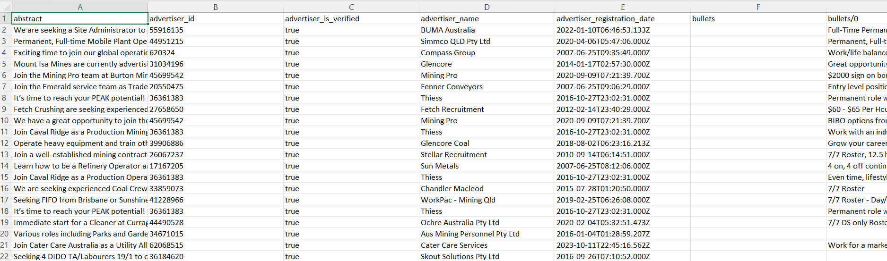

Dashboard with job datasets of certain Queensland industries.

This project is a prototype meant to be used directly for a non-disclosed company which required a solution to gather jobs in the referred industries using automation.

What it does

An interactive Streamlit dashboard that turns a cleaned job-ads spreadsheet into a view of the Queensland job market. Load a file, filter it, read the charts, and download the filtered rows.

Filters (sidebar)

Category
City
Contract time

Key metrics

Total jobs
Unique companies
Jobs with salary information
Average salary

Charts

Top 10 hiring companies (bar)
Jobs by location (pie, top 10)
Contract time split (pie)
Salary distribution (histogram)
Average salary by category (bar)
Jobs posted over time (line)

Data table and export

Pick which columns to show in the raw data table.
Download the filtered data as a dated CSV.

Jobs without salary information are left out of the salary charts, and the dashboard still works if optional columns such as city or salary_avg are missing.

Quick start
Install the dependencies:
bash
   pip install -r requirements.txt
Start the app:
bash
   streamlit run dashboard.py
In the sidebar, choose Upload File and select an Excel file (.xlsx or .xls), or choose Use Sample Data to load cleaned_datasets/queensland_all_jobs.xlsx if that file is present next to dashboard.py.

To run it online without installing anything locally, the repository can be deployed on Streamlit Community Cloud with dashboard.py as the main file.

Expected data

One row per job ad, in an Excel file with these columns:

Column	Used for	Required
title	Raw data table	Yes
company	Unique companies, top hiring companies	Yes
location	Jobs by location	Yes
category	Category filter, average salary by category	Yes
contract_time	Contract time filter and chart	Yes
created	Jobs posted over time (parsed as a date)	Yes
salary_min, salary_max	Salary metrics and charts	Yes
city	City filter	Optional
salary_avg	Used instead of the min/max midpoint when present	Optional
has_salary	Used instead of counting non-empty salary_min when present	Optional
Data collection

The jobs are gathered by an automated pipeline that runs separately from this dashboard. The pipeline and the datasets belong to the client and are not part of this repository. The dashboard only reads the cleaned Excel output.

Status

Prototype, built to validate the approach with the client.

Still to do:

Add a Power BI report alongside the Streamlit dashboard.
Add an anonymised sample dataset and a screenshot.
Document the pipeline interface, meaning the columns and file name it hands over.
Built with
Python
Streamlit for the web interface
pandas and openpyxl for loading and shaping the data
Plotly Express for the charts
requests, for the data-collection side
Author

Edy dos Santos. More projects: github.com/edy-dos-santos/myportfolio
